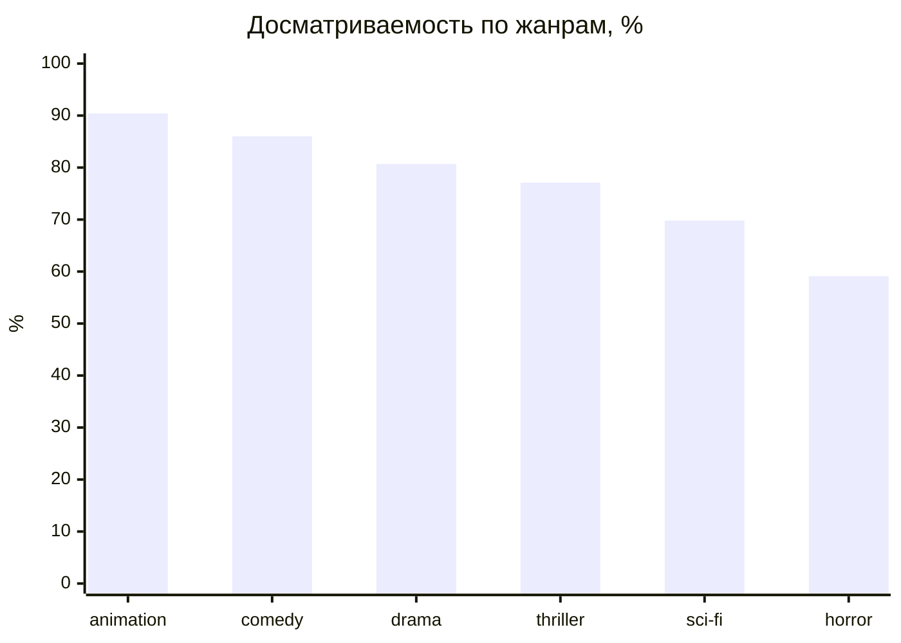
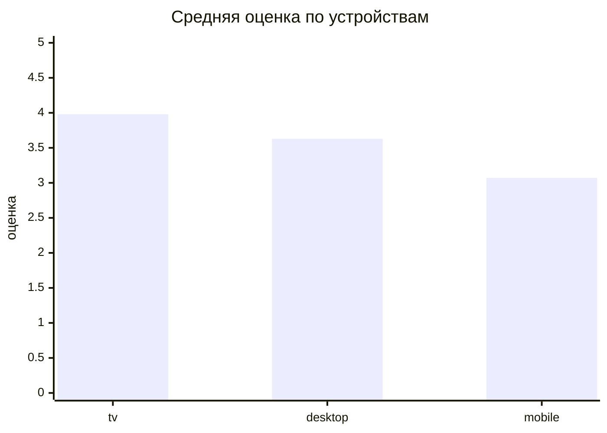
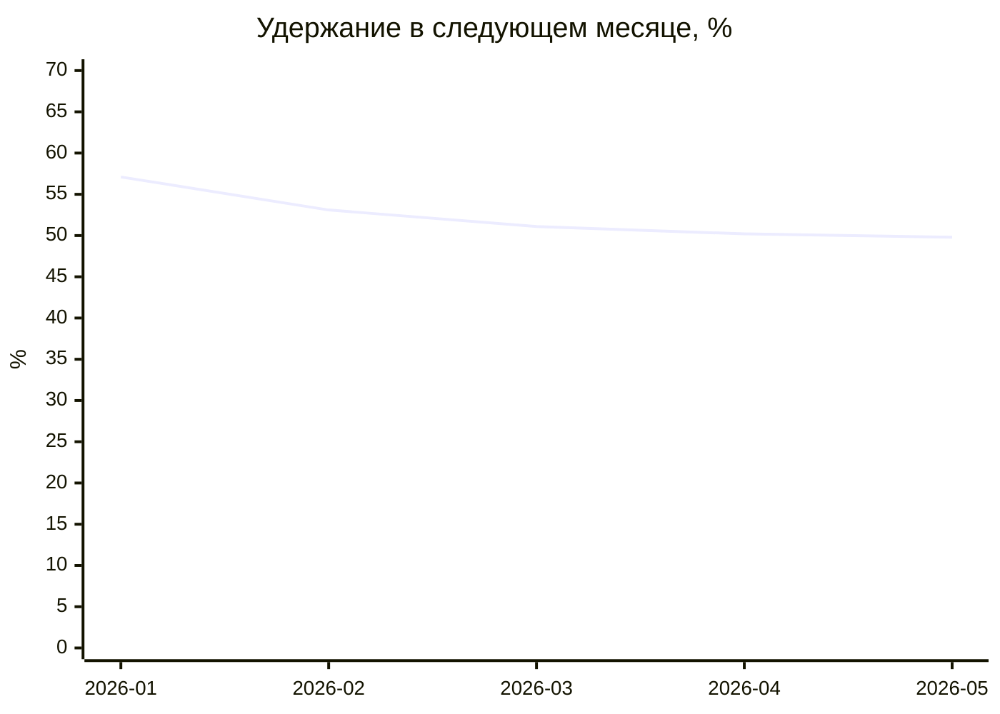

# Аналитика онлайн-кинотеатра на SQL

Пет-проект: анализ поведения пользователей онлайн-кинотеатра — что смотрят, где досматривают, как оценивают и возвращаются ли.

## Цель

Ответить на продуктовые вопросы с помощью SQL и превратить цифры в выводы для бизнеса: какие жанры и устройства теряют зрителя, где пользователи активнее, как меняется удержание, какие фильмы продвигать.

## Данные

| Таблица | Что хранит | Строк |
|---|---|---|
| `users` | пользователи: город, дата регистрации | 800 |
| `views` | просмотры: фильм, жанр, длительность, статус `completed` / `cancelled` | 1 817 |
| `reviews` | отзывы: устройство (`tv`, `mobile`, `desktop`), оценка 1–5 | 1 022 |

Данные синтетические (сгенерированы скриптом с фиксированным seed, с реалистичными закономерностями), период — январь–июнь 2026. Запросы выполнены в SQLite.

**Приёмы SQL:** `JOIN` / `LEFT JOIN`, `GROUP BY` + `HAVING`, `CASE WHEN`, `COUNT(DISTINCT)`, CTE (`WITH`), оконные функции (`LEAD`, `RANK`), `UNION ALL`.

## Главные выводы

1. **Досматривают 77% просмотров**, в среднем 2,9 просмотра на активного пользователя.
2. **Хорроры и фантастика теряют зрителя:** досматриваемость 59% и 70% против 90% у мультфильмов, и самые низкие оценки. → Проверить каталог и рекомендации в этих жанрах.
3. **Мобильные пользователи недовольны:** на ТВ досматривают 84% и ставят 3,98, на мобильных — 67,5% и 3,07. → Мобильное приложение — главная точка роста.
4. **Удержание падает** с 57% до 50% за полгода. → Запустить реактивацию тех, кто не заходил месяц.
5. **Москва даёт больше всего просмотров, но самые вовлечённые — Казань и Самара.**
6. **Лидеры по оценкам** — «Город игрушек», «Чужой след», «Лис и звёзды»: кандидаты для промо.

---

## 0. Проверка качества данных

Перед анализом — 7 проверок. Все пройдены, ошибок 0.

```sql
-- Проверка качества данных перед анализом

-- 1. Дубли ключей: должно быть 0
SELECT 'дубли view_id' AS проверка, COUNT(*) - COUNT(DISTINCT view_id) AS результат FROM views
UNION ALL
SELECT 'дубли user_id', COUNT(*) - COUNT(DISTINCT user_id) FROM users
UNION ALL
-- 2. Пропуски в важных полях
SELECT 'пустой status или duration', COUNT(*) FROM views WHERE status IS NULL OR duration_min IS NULL
UNION ALL
-- 3. «Сироты»: отзыв на несуществующий просмотр
SELECT 'отзывы без просмотра', COUNT(*) FROM reviews r LEFT JOIN views v ON v.view_id = r.view_id WHERE v.view_id IS NULL
UNION ALL
-- 4. Оценка вне диапазона 1–5
SELECT 'оценка вне 1–5', COUNT(*) FROM reviews WHERE rating NOT BETWEEN 1 AND 5
UNION ALL
-- 5. Отзыв раньше просмотра — логическая ошибка
SELECT 'отзыв раньше просмотра', COUNT(*) FROM reviews r JOIN views v ON v.view_id = r.view_id WHERE r.review_date < v.view_date
UNION ALL
-- 6. Просмотр раньше регистрации
SELECT 'просмотр до регистрации', COUNT(*) FROM views v JOIN users u ON u.user_id = v.user_id WHERE v.view_date < u.signup_date;
```

| проверка | результат |
|---|---|
| дубли view_id | 0 |
| дубли user_id | 0 |
| пустой status или duration | 0 |
| отзывы без просмотра | 0 |
| оценка вне 1–5 | 0 |
| отзыв раньше просмотра | 0 |
| просмотр до регистрации | 0 |

## 1. Общая картина

```sql
-- Общая картина: сколько просмотров и какая доля досмотрена
SELECT
    COUNT(*)                                                    AS всего_просмотров,
    SUM(CASE WHEN status = 'completed' THEN 1 ELSE 0 END)       AS завершено,
    ROUND(100.0 * AVG(CASE WHEN status = 'completed' THEN 1 ELSE 0 END), 1) AS доля_досмотра_проц,
    COUNT(DISTINCT user_id)                                     AS активных_пользователей,
    ROUND(1.0 * COUNT(*) / COUNT(DISTINCT user_id), 2)          AS просмотров_на_пользователя
FROM views;
```

| всего просмотров | завершено | доля досмотра проц | активных пользователей | просмотров на пользователя |
|---|---|---|---|---|
| 1817.0 | 1403.0 | 77.2 | 624.0 | 2.91 |

## 2. Жанры

```sql
-- Жанры: популярность, досматриваемость и средняя оценка
SELECT
    v.genre                                                       AS жанр,
    COUNT(*)                                                      AS просмотров,
    ROUND(100.0 * AVG(CASE WHEN v.status = 'completed' THEN 1 ELSE 0 END), 1) AS доля_досмотра_проц,
    ROUND(AVG(r.rating), 2)                                       AS средняя_оценка
FROM views v
LEFT JOIN reviews r ON r.view_id = v.view_id   -- LEFT: просмотры без отзыва тоже считаем
GROUP BY v.genre
ORDER BY доля_досмотра_проц DESC;
```

| жанр | просмотров | доля досмотра проц | средняя оценка |
|---|---|---|---|
| animation | 293 | 90.4 | 4.12 |
| comedy | 314 | 86.0 | 3.77 |
| drama | 326 | 80.7 | 3.79 |
| thriller | 280 | 77.1 | 3.85 |
| sci-fi | 301 | 69.8 | 3.13 |
| horror | 303 | 59.1 | 2.72 |



## 3. Устройства

```sql
-- Устройства: где досматривают и как оценивают
SELECT
    r.device                                                      AS устройство,
    COUNT(*)                                                      AS отзывов,
    ROUND(100.0 * AVG(CASE WHEN v.status = 'completed' THEN 1 ELSE 0 END), 1) AS доля_досмотра_проц,
    ROUND(AVG(r.rating), 2)                                       AS средняя_оценка
FROM reviews r
JOIN views v ON v.view_id = r.view_id
GROUP BY r.device
ORDER BY средняя_оценка DESC;
```

| устройство | отзывов | доля досмотра проц | средняя оценка |
|---|---|---|---|
| tv | 374 | 84.0 | 3.98 |
| desktop | 288 | 79.9 | 3.63 |
| mobile | 360 | 67.5 | 3.07 |



## 4. Города

```sql
-- Города: активность пользователей
SELECT
    u.city                                                        AS город,
    COUNT(DISTINCT u.user_id)                                     AS пользователей,
    COUNT(v.view_id)                                              AS просмотров,
    ROUND(1.0 * COUNT(v.view_id) / COUNT(DISTINCT u.user_id), 2)  AS просмотров_на_пользователя
FROM users u
LEFT JOIN views v ON v.user_id = u.user_id   -- LEFT: учитываем и тех, кто ничего не смотрел
GROUP BY u.city
ORDER BY просмотров DESC;
```

| город | пользователей | просмотров | просмотров на пользователя |
|---|---|---|---|
| Москва | 244 | 533 | 2.18 |
| Санкт-Петербург | 136 | 315 | 2.32 |
| Казань | 83 | 215 | 2.59 |
| Екатеринбург | 75 | 173 | 2.31 |
| Самара | 62 | 156 | 2.52 |
| Тула | 70 | 144 | 2.06 |
| Краснодар | 61 | 141 | 2.31 |
| Новосибирск | 69 | 140 | 2.03 |

## 5. Динамика по месяцам

```sql
-- Динамика по месяцам
SELECT
    SUBSTR(view_date, 1, 7)                                       AS месяц,
    COUNT(*)                                                      AS просмотров,
    COUNT(DISTINCT user_id)                                       AS активных_пользователей,
    ROUND(100.0 * AVG(CASE WHEN status = 'completed' THEN 1 ELSE 0 END), 1) AS доля_досмотра_проц
FROM views
GROUP BY месяц
ORDER BY месяц;
```

| месяц | просмотров | активных пользователей | доля досмотра проц |
|---|---|---|---|
| 2026-01 | 80 | 56 | 81.3 |
| 2026-02 | 167 | 113 | 74.9 |
| 2026-03 | 304 | 186 | 80.6 |
| 2026-04 | 371 | 253 | 74.7 |
| 2026-05 | 467 | 295 | 77.5 |
| 2026-06 | 428 | 267 | 76.9 |

## 6. Удержание (CTE + оконная функция LEAD)

```sql
-- Удержание: какая доля пользователей месяца вернулась в следующем месяце
WITH monthly AS (                       -- кто был активен в каком месяце
    SELECT DISTINCT user_id, SUBSTR(view_date, 1, 7) AS month
    FROM views
),
pairs AS (                              -- следующий месяц активности пользователя
    SELECT
        user_id,
        month,
        LEAD(month) OVER (PARTITION BY user_id ORDER BY month) AS next_month
    FROM monthly
)
SELECT
    month                                                         AS месяц,
    COUNT(*)                                                      AS активных,
    SUM(CASE WHEN next_month = STRFTIME('%Y-%m', DATE(month || '-01', '+1 month')) THEN 1 ELSE 0 END) AS вернулись,
    ROUND(100.0 * SUM(CASE WHEN next_month = STRFTIME('%Y-%m', DATE(month || '-01', '+1 month')) THEN 1 ELSE 0 END) / COUNT(*), 1) AS удержание_проц
FROM pairs
WHERE month < '2026-06'                 -- для июня следующего месяца в данных нет
GROUP BY month
ORDER BY month;
```

| месяц | активных | вернулись | удержание проц |
|---|---|---|---|
| 2026-01 | 56 | 32 | 57.1 |
| 2026-02 | 113 | 60 | 53.1 |
| 2026-03 | 186 | 95 | 51.1 |
| 2026-04 | 253 | 127 | 50.2 |
| 2026-05 | 295 | 147 | 49.8 |



## 7. Топ фильмов (HAVING + RANK)

```sql
-- Лучшие фильмы по оценке среди тех, кого посмотрели минимум 20 разных зрителей
WITH movie_stats AS (
    SELECT
        v.movie_title,
        v.genre,
        COUNT(DISTINCT v.user_id)      AS зрителей,
        ROUND(AVG(r.rating), 2)        AS средняя_оценка
    FROM views v
    JOIN reviews r ON r.view_id = v.view_id
    WHERE v.status = 'completed'
    GROUP BY v.movie_title, v.genre
    HAVING COUNT(DISTINCT v.user_id) >= 20
)
SELECT
    RANK() OVER (ORDER BY средняя_оценка DESC) AS место,
    movie_title AS фильм,
    genre       AS жанр,
    зрителей,
    средняя_оценка
FROM movie_stats
ORDER BY место, фильм
LIMIT 10;
```

| место | фильм | жанр | зрителей | средняя оценка |
|---|---|---|---|---|
| 1 | Город игрушек | animation | 66 | 4.29 |
| 2 | Чужой след | thriller | 51 | 4.23 |
| 3 | Лис и звёзды | animation | 66 | 4.21 |
| 4 | Грань | thriller | 41 | 4.2 |
| 5 | Тихий берег | drama | 39 | 4.15 |
| 6 | Ветер перемен | drama | 36 | 4.1 |
| 7 | Офисный роман 2.0 | comedy | 54 | 4.07 |
| 8 | Ну и денёк | comedy | 45 | 4.06 |
| 8 | Последнее письмо | drama | 31 | 4.06 |
| 10 | Ночной звонок | thriller | 40 | 4.02 |
